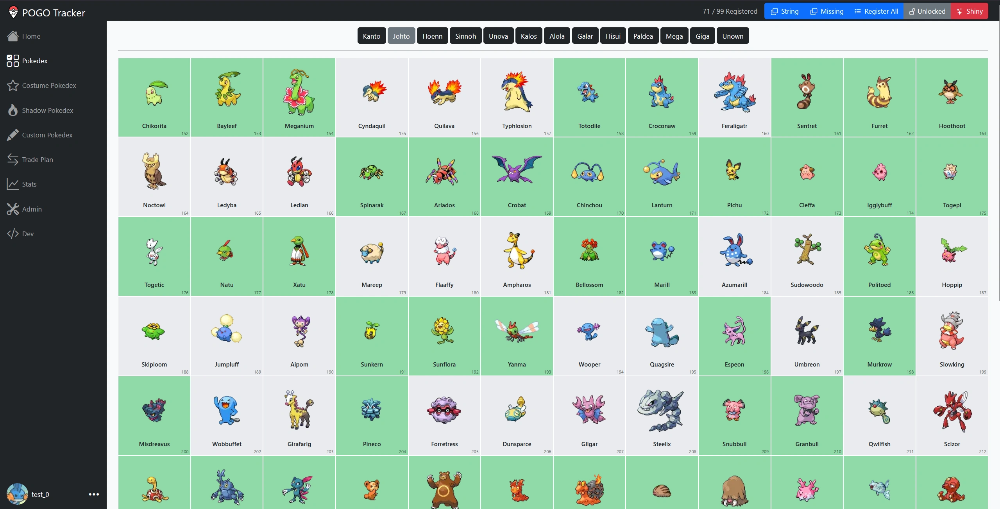

# POGO Tracker

POGO Tracker offers in-depth analytics on your Pokemon collection, catches, walking distance, medal achievements, and much more.



## Features

### Pokedex

- Track catches, shiny catches, and shadow catches across all regions, mega forms, gigantamax forms, and unown

### Custom Pokedex

- User-entered subsets of Pokemon that use pokedex information to see completion
- System generated subsets that match upcoming in-game events

### Trade Plan

- Find mismatches between your collection and a friend's collection to trade

### Stats

- Track daily km walked, catches, pokestops spun, and xp
- Track medal progress
- See breakdown of progress

## Documentation

- Deployment: `docs/deployment.md`
- Development workflows: `docs/development.md`

## Dev Docker Setup

See `docs/development.md` on how to run without using Docker.

Follow these steps to run the App + PostgreSQL database locally in Docker.

The database container will automatically be seeded with dev data.

### Prerequisites

- Docker Desktop

### Setup

1. Using `docker/.env.docker.example` as a template, populate `app/.env`

2. Install NPM packages from root - the app is bind mounted, so this must run before the server starts

    ```bash
    cd app/includes
    npm install
    cd ../..
    ```

3. Setup GitHooks from root

    ```bash
    npm install -g lefthook
    lefthook install
    ```

4. Run the 'Post-checkout' GitHook

    ```bash
    lefthook run post-checkout
    ```

5. Navigate to Docker dir

    ```
    cd docker
    ```

6. Start docker

    ```
    docker compose up -d
    ```

7. Verify app is running (this may be a few minutes on first start)
    - **Health Check**: http://localhost:8083/healthcheck
    - **App**: http://localhost:8083

8. Stop containers by running

    ```
    docker compose down
    ```

### Commands

- Stop containers and clear all data

    ```
    docker compose down -v
    ```

- Restart the containers

    ```
    docker compose restart
    ```

- View logs from all services

    ```
    docker compose logs -f
    ```

- View logs from specific service

    ```
    docker compose logs -f pogotracker_app
    docker compose logs -f pogotracker_db
    ```

### Connecting to database

| Setting      | Value                |
| ------------ | -------------------- |
| **Host**     | `localhost`          |
| **Port**     | `5434`               |
| **Database** | `pogotracker_db`     |
| **Username** | `pogotracker_docker` |
| **Password** | `docker1234`         |
| **Schema**   | `public`             |
